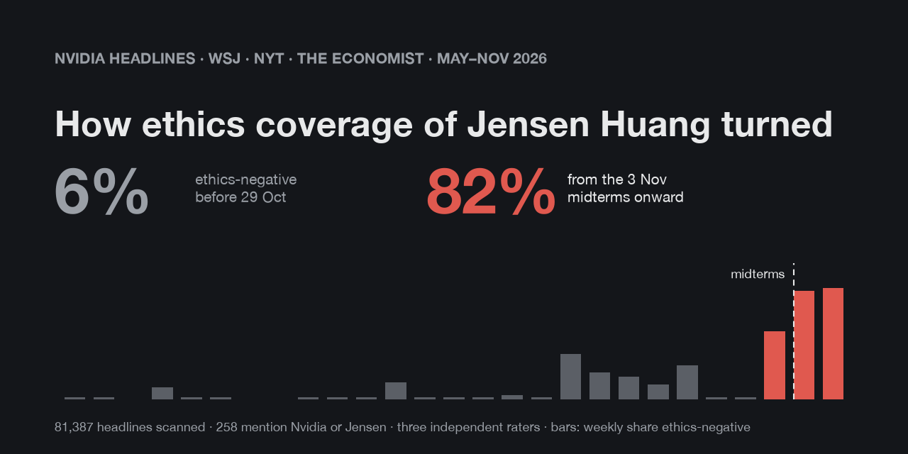
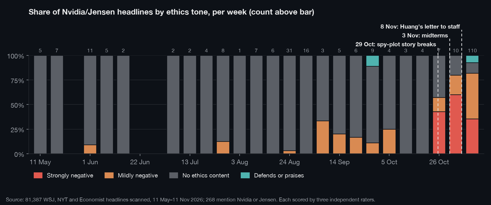
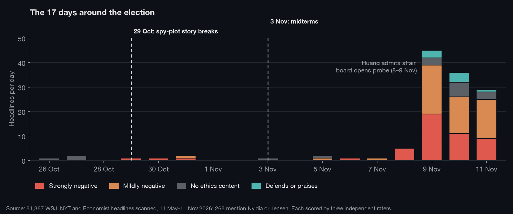
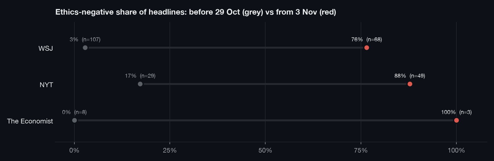

# Nvidia headlines and ethics sentiment, May–Nov 2026



Every headline containing "Nvidia" or "Jensen" published by **The Wall Street Journal**, **The New York Times** and **The Economist** between 11 May and 11 Nov 2026, scored for ethics sentiment. The question was whether coverage of Jensen Huang turned negative after the US midterm elections on 3 Nov 2026.

## Finding

| Period | Headlines | Ethics-negative | Mean score (−2 to +2) |
|---|---:|---:|---:|
| 11 May – 28 Oct | 144 | 6% | −0.05 |
| 29 Oct – 2 Nov (spy-plot story breaks) | 4 | 100% | −1.75 |
| **3 – 11 Nov (election and after)** | **120** | **82%** | **−1.12** |
| of which 3 – 7 Nov | 5 | 60% | −0.80 |
| of which 8 – 11 Nov | 115 | 83% | −1.14 |

Sentiment did turn after the election, but the election is not what turned it.

- The break came on **29 Oct**, five days before the vote, when the NYT reported that Huang was seen as the target of a Chinese spy plot.
- The surge came on **8–9 Nov**, when Huang acknowledged an affair and Nvidia's board opened a probe. 115 of the 120 post-election headlines are from 8–11 Nov.
- The data cannot separate an election effect from the scandal, because the post-election period is almost entirely one news cycle about one story.

Headlines about Huang himself went from a mean of −0.06 before 29 Oct (17 headlines) to −1.18 from 3 Nov (79 headlines).







Every headline and its scores are listed [below](#headlines). An interactive version is in [`site/index.html`](site/index.html).

## Was the negativity written in?

A separate audit of how the headlines are worded is in [`analysis/framing-audit.md`](analysis/framing-audit.md). It ran on the first 168 headlines. In short:

- **Verdict:** no evidence of deliberate negative framing, at about 75% confidence. Headlines cannot show intent. The tone is mostly carried by the facts reported.
- **Lapses:** there are specific, checkable lapses that all point against Huang.
  - Spy claims are stated more firmly than the outlets' own summaries support.
  - NYT's "Halted" describes an inquiry that was moved.
  - WSJ's "Downfall" ran on a day its other headlines said "possible exit".
  - "Plunge" describes a 4.3% fall.
  - Alice Huang is mostly called "woman", or a sexualised term, rather than an executive.
- **Counter-framing:** sympathetic headlines appear throughout, and WSJ repeated good news (the Hugging Face deal) just as heavily.

## Method

**Collection.** Headlines were read on 11–12 Nov 2026 from each outlet's public listing pages in a desktop browser:
- **WSJ:** the daily news archive for all 185 days, plus site search.
- **NYT:** the daily sitemaps for all 185 days, plus site search for "Nvidia" and "Jensen".
- **The Economist:** the 26 weekly editions and site search.

A headline was kept if it contains "Nvidia" or "Jensen" (case-insensitive) and is dated in the window. Exact duplicates within an outlet were removed, leaving 268: WSJ 177, NYT 80, The Economist 11. No article text was collected or stored.

**Scoring.** Three Claude Opus 5.5 instances scored every headline independently. Each saw only the headline and the outlet's one-line summary, not the other raters' scores. The rubric:

| Score | Meaning |
|---:|---|
| −2 | Strongly negative on ethics or integrity: misconduct, spying, deception, cover-up, infidelity scandal, improper influence, calls for resignation |
| −1 | Mildly negative: scrutiny, an investigation of a deal, governance or conflict-of-interest concerns, safety or ethics debate, risk of misuse, accounting doubts, a scandal's market consequences |
| 0 | No ethics content: ordinary business, products, earnings, stock moves unrelated to a scandal |
| +1 | Mildly positive: defends or sympathises with Huang or Nvidia on integrity, reports a denial |
| +2 | Strongly positive: clear praise of ethical conduct, exoneration |

The charts use the median of the three scores. "Ethics-negative" means a median of −1 or −2.

**Agreement.**

| Raters | Same score | Quadratic weighted kappa |
|---|---:|---:|
| A and B | 92.9% | 0.95 |
| A and C | 94.4% | 0.96 |
| B and C | 94.0% | 0.95 |

All three gave the same score on 243 of 268 headlines and never differed by more than one point. The before-and-after gap holds for each rater alone: 5–7% ethics-negative before 29 Oct, 79–82% from 3 Nov.

## Limitations

- **Shared blind spots:** the three raters are the same model using one rubric, so they share any blind spot in it. High agreement shows consistency, not correctness. Human raters would be a stronger check.
- **Scores track volume:** most headlines are plain business news and score 0, so the means largely track how many scandal headlines there are.
- **WSJ:** the WSJ daily archive leaves out live-coverage posts, videos and podcasts. Those are included only where site search found them, so they are undercounted before November. WSJ also re-headlines one event many times a day across live blogs, newsletters and podcasts, which inflates November counts.
- **The Economist:** coverage is incomplete. Access was interrupted partway through, and some candidate articles were not checked, so its 11 headlines are a floor. Pieces whose headline does not contain "Nvidia" or "Jensen" are excluded by design, even when they are about the affair.
- **Dates:** WSJ dates are US Eastern. Some dates are a day off from the publication time because of time-zone or update-time effects.
- **Claims:** the spy and affair claims are as reported by these outlets and were not independently verified.

## Files

| Path | What it is |
|---|---|
| `data/headlines.csv`, `data/headlines.json` | One row per headline: `id`, `outlet`, `date`, `headline`, `print_headline` (Economist print title where it differs), `url`, `rater_a`, `rater_b`, `rater_c`, `median_score`, `about_huang` (1 if the headline names Huang or the CEO) |
| `data/summary.json` | Every figure above, computed from the CSV |
| `scripts/analyze.py` | Recomputes `summary.json`, the charts, the preview image and the headline list in this README from the CSV |
| `charts/` | The three charts above |
| `site/index.html` | Interactive chart and full headline list |
| `analysis/framing-audit.md` | Headline wording audit |

To reproduce:

```
pip install matplotlib pillow
python scripts/analyze.py
```

## Rights

Headlines remain the property of their publishers and are reproduced here, with links to the originals, only as the subject of this analysis. The repo contains no article text. The scores, summary figures, charts and written analysis are released under [CC BY 4.0](https://creativecommons.org/licenses/by/4.0/). The code is under the MIT License (see `LICENSE`).

## Headlines

<!-- HEADLINES:START -->
<details open>
<summary><b>All 268 scored headlines</b> (newest first)</summary>

🟥 strongly negative · 🟧 mildly negative · ⬜ no ethics content · 🟩 defends or praises

| Date | Outlet | Median | Raters A / B / C | Headline |
|---|---|:-:|:-:|---|
| 2026-11-11 | WSJ | 🟥 -2 | -1 / -2 / -2 | [🎧 Listen:  How Nvidia CEO’s Affair Became a National Concern](https://www.wsj.com/livecoverage/stock-market-today-dow-sp-500-nasdaq-11-11-2026/card/-listen-how-nvidia-ceo-s-affair-became-a-national-security-nightmare-cmgDg5vhXS7m4tht4hK2) |
| 2026-11-11 | WSJ | ⬜ 0 | -1 / 0 / 0 | [Who Is the Short-Seller That Bet Against Jensen Huang and Nvidia?](https://www.wsj.com/livecoverage/stock-market-today-dow-sp-500-nasdaq-11-11-2026/card/who-is-the-short-seller-that-bet-against-jensen-huang-and-nvidia--ywPKJngYFflrx9zKTjzh) |
| 2026-11-11 | WSJ | 🟧 -1 | -1 / -1 / -1 | [Top Democrats Target Trump Administration’s Nvidia-China Records](https://www.wsj.com/politics/policy/top-democrats-target-trump-administrations-nvidia-china-records-0c212746) |
| 2026-11-11 | WSJ | 🟧 -1 | -1 / -1 / -1 | [The 31-Year-Old Trader Who Called Out Jensen Huang’s ‘China Problem’—and Shorted Nvidia](https://www.wsj.com/business/nvidia-short-seller-culper-jensen-huang-0e0cec38) |
| 2026-11-11 | WSJ | ⬜ 0 | 0 / 0 / 0 | [Stocks to Watch Recap: CoreWeave, Nvidia, TSMC](https://www.wsj.com/livecoverage/stock-market-today-dow-sp-500-nasdaq-11-11-2026/card/stocks-to-watch-coreweave-nvidia-tsmc-EbakJv4ZyAl7obXOSamP) |
| 2026-11-11 | WSJ | 🟧 -1 | -1 / -1 / -1 | [Stock Market Today: Nvidia Stock Slides as Board Considers Ousting CEO](https://www.wsj.com/livecoverage/stock-market-today-dow-sp-500-nasdaq-11-11-2026) |
| 2026-11-11 | WSJ | 🟧 -1 | -1 / -1 / -1 | [Nvidia’s Disappearing Singapore Sales Deepen Mystery Around Megaspeed](https://www.wsj.com/business/earnings/nvidias-disappearing-singapore-sales-deepen-mystery-around-megaspeed-7d483180) |
| 2026-11-11 | WSJ | 🟧 -1 | -1 / -1 / -1 | [Nvidia Stock Falls Afterhours on Possible Jensen Huang Exit](https://www.wsj.com/livecoverage/stock-market-today-dow-sp-500-nasdaq-11-11-2026/card/nvidia-stock-falls-afterhours-following-report-on-possible-jensen-huang-exit-qpZL3zuTAbNYQZfpIyaU) |
| 2026-11-11 | WSJ | 🟥 -2 | -2 / -2 / -2 | [Nvidia Is Preparing to Oust CEO Jensen Huang](https://www.wsj.com/business/nvidia-is-preparing-to-oust-nvidia-ceo-jensen-huang-30f421ad) |
| 2026-11-11 | WSJ | 🟥 -2 | -2 / -2 / -2 | [Nvidia CEO’s Sudden Downfall Creates Nightmare for White House](https://www.wsj.com/articles/nvidia-ceos-sudden-downfall-creates-nightmare-for-white-house-04b2b977) |
| 2026-11-11 | WSJ | 🟧 -1 | -1 / -1 / -1 | [Jensen Huang Affair Strains Taiwan’s Devotion to Its Hometown Hero](https://www.wsj.com/world/asia/the-jensen-huang-scandal-is-testing-taiwans-devotion-to-its-hometown-hero-2a2914d9) |
| 2026-11-11 | WSJ | 🟥 -2 | -2 / -2 / -2 | [Huang Might Need to Step Down as Nvidia’s Top Exec, Baird Says](https://www.wsj.com/livecoverage/stock-market-today-dow-sp-500-nasdaq-11-11-2026/card/huang-might-need-to-step-down-as-nvidia-s-top-exec-baird-says-Ipn9cQc0rwQqyzTmu1bb) |
| 2026-11-11 | WSJ | 🟧 -1 | -1 / -1 / -1 | [CoreWeave CEO Weighs In on Nvidia](https://www.wsj.com/livecoverage/stock-market-today-dow-sp-500-nasdaq-11-11-2026/card/coreweave-ceo-weighs-in-on-nvidia-4fr21utIkt36zl7x9xEx) |
| 2026-11-11 | WSJ | 🟧 -1 | -1 / -1 / -1 | [Big Questions Would Hang Over Nvidia if Huang Leaves as CEO](https://www.wsj.com/livecoverage/stock-market-today-dow-sp-500-nasdaq-11-11-2026/card/big-questions-would-hang-over-nvidia-if-huang-leaves-as-ceo-KKKweLaywIlcSY40u7fc) |
| 2026-11-11 | WSJ | 🟧 -1 | -1 / -1 / -1 | [A Timeline of Nvidia CEO Jensen Huang’s Suspected Spy Drama](https://www.wsj.com/tech/ai/a-timeline-of-nvidia-ceo-jensen-huangs-suspected-spy-drama-05cbebf3) |
| 2026-11-11 | NYT | 🟧 -1 | -1 / -1 / -1 | [Trump Officials Clashed Over Firm at Heart of Nvidia Affair](https://www.nytimes.com/2026/11/11/business/economy/nvidia-affair-spy-bessent-lutnick.html) |
| 2026-11-11 | NYT | 🟧 -1 | -1 / -1 / -1 | [This Trader Raised Alarm About Nvidia’s China Entanglements Months Ago](https://www.nytimes.com/2026/11/11/business/nvidia-megaspeed-christian-lamarco.html) |
| 2026-11-11 | NYT | 🟩 +1 | +1 / +1 / +1 | [Tech Allies Rally Behind Jensen Huang, Calling Him Vital in A.I. Race](https://www.nytimes.com/2026/11/11/technology/jensen-huang-affair-nvidia-support.html) |
| 2026-11-11 | NYT | 🟥 -2 | -1 / -2 / -2 | [Nvidia’s Board Is Meeting to Discuss Jensen Huang’s Future](https://www.nytimes.com/2026/11/11/technology/nvidia-jensen-huang.html) |
| 2026-11-11 | NYT | 🟧 -1 | -1 / -1 / -1 | [Nvidia Shares Plummet as Board Is Said to Consider C.E.O.’s Future](https://www.nytimes.com/2026/11/11/business/nvidia-stock-jensen-huang-ceo.html) |
| 2026-11-11 | NYT | 🟧 -1 | -1 / -1 / -1 | [Nvidia Scandal Unveils a Fierce Spy War Raging Behind Trump and Xi’s Diplomacy](https://www.nytimes.com/2026/11/11/world/asia/china-us-nvidia.html) |
| 2026-11-11 | NYT | 🟧 -1 | -1 / -1 / -1 | [La infidelidad de Jensen Huang pone a su esposa bajo el reflector](https://www.nytimes.com/es/2026/11/11/espanol/negocios/jensen-huang-esposa-nvidia.html) |
| 2026-11-11 | NYT | 🟧 -1 | -1 / -1 / -1 | [Jensen Huang’s Affair Puts His Wife in the Spotlight](https://www.nytimes.com/2026/11/11/technology/jensen-huang-affair-lori-huang.html) |
| 2026-11-11 | NYT | 🟥 -2 | -2 / -2 / -2 | [Jensen Huang Said to Have Had Relationship With Nvidia Executive Who Reports to Him](https://www.nytimes.com/2026/11/11/technology/jensen-huang-nvidia-affair.html) |
| 2026-11-11 | NYT | 🟧 -1 | -1 / -1 / -1 | [Jensen Huang Betrayed the Leather Jacket Community](https://www.nytimes.com/2026/11/11/opinion/jensen-huang-leather-jacket.html) |
| 2026-11-11 | NYT | 🟥 -2 | -2 / -2 / -2 | [How a Suspected Chinese Spy Gained Access to Nvidia Chips](https://www.nytimes.com/video/business/100000011273241/alice-huang-nvidia-china-spy.html) |
| 2026-11-11 | NYT | 🟥 -2 | -2 / -2 / -2 | [Employees Say Jensen Huang Had Relationship With Nvidia Executive](https://www.nytimes.com/video/technology/100000011278550/huang-second-extramarital-relationship.html) |
| 2026-11-11 | NYT | ⬜ 0 | 0 / 0 / -1 | [Could Jensen Huang’s Family Take Over Nvidia?](https://www.nytimes.com/video/technology/100000011276347/could-jensen-huangs-family-take-over-nvidia.html) |
| 2026-11-11 | The Economist | 🟥 -2 | -2 / -2 / -2 | [Jensen Huang must resign](https://www.economist.com/leaders/2026/11/11/jensen-huang-must-resign) |
| 2026-11-10 | WSJ | ⬜ 0 | 0 / 0 / 0 | [Why Nvidia CEO Jensen Huang Is Unique](https://www.wsj.com/cio-journal/why-nvidia-ceo-jensen-huang-is-unique-586439c8) |
| 2026-11-10 | WSJ | 🟧 -1 | -1 / -1 / -1 | [What the Jensen Huang Investigation Means for Nvidia](https://www.wsj.com/podcasts/tech-news-briefing/what-the-jensen-huang-investigation-means-for-nvidia/8F4A9933-39CF-432A-96AC-257AB9A7E69F) |
| 2026-11-10 | WSJ | 🟧 -1 | -1 / -1 / -1 | [VIDEO: What the Jensen Huang Scandal Could Mean for Nvidia](https://www.wsj.com/video/what-the-jensen-huang-scandal-could-mean-for-nvidia/B92FD940-4395-4A04-9923-E5E751EA38D1) |
| 2026-11-10 | WSJ | 🟩 +1 | +1 / 0 / +1 | [The Temptation of Jensen Huang](https://www.wsj.com/opinion/free-expression/the-temptation-of-jensen-huang-9c3cf44c) |
| 2026-11-10 | WSJ | 🟧 -1 | -1 / -1 / -1 | [The Nvidia Affair Is Terrible Timing for Corporate America](https://www.wsj.com/finance/investing/the-nvidia-affair-is-terrible-timing-for-corporate-america-aa3166c2) |
| 2026-11-10 | WSJ | 🟧 -1 | -1 / -1 / -1 | [The Morning Risk Report: Jensen Huang Doesn’t Believe in Succession Planning. It’s Become a Big Risk for Nvidia.](https://www.wsj.com/risk-compliance-journal/the-morning-risk-report-jensen-huang-doesnt-believe-in-succession-planning-its-become-a-big-risk-for-nvidia-359880b4) |
| 2026-11-10 | WSJ | ⬜ 0 | 0 / 0 / 0 | [Stocks to Watch: SoftBank, Nvidia, CoreWeave](https://www.wsj.com/livecoverage/stock-market-cpi-inflation-11-10-2026/card/stocks-to-watch-softbank-nvidia-rocket-lab-eHw0kcmPEkygIsePiWKh) |
| 2026-11-10 | WSJ | ⬜ 0 | 0 / 0 / 0 | [Nvidia’s Valuation Hits Lowest Level Since 2011, by One Measure](https://www.wsj.com/livecoverage/stock-market-cpi-inflation-11-10-2026/card/nvidia-s-valuation-hits-lowest-level-since-2011-by-one-measure-IwMsb0vJsfkuzlTAx1gN) |
| 2026-11-10 | WSJ | 🟧 -1 | -1 / -1 / -1 | [Nvidia’s Scandal Is Spreading to Washington](https://www.wsj.com/podcasts/minute-briefing/nvidias-scandal-is-spreading-to-washington/2295326F-102A-465D-BE8F-53A3BA4CEB67) |
| 2026-11-10 | WSJ | 🟧 -1 | -1 / -1 / -1 | [Nvidia Scandal Tests the Resilience of the Global AI Boom](https://www.wsj.com/tech/ai/jensen-huang-nvidia-ceo-ai-bubble-93097556) |
| 2026-11-10 | WSJ | ⬜ 0 | 0 / 0 / 0 | [Microsoft Falls Short of Surpassing Nvidia in Market Value](https://www.wsj.com/livecoverage/stock-market-cpi-inflation-11-10-2026/card/microsoft-is-on-pace-to-surpass-nvidia-as-world-s-third-largest-company-1Ss4CPMoaFNwy5hOqdL8) |
| 2026-11-10 | WSJ | 🟧 -1 | -1 / -1 / -1 | [Law Firm Wachtell Lipton to Lead Nvidia Internal Investigation](https://www.wsj.com/tech/law-firm-wachtell-lipton-to-lead-nvidia-internal-investigation-d37731c7) |
| 2026-11-10 | WSJ | 🟩 +1 | +1 / +1 / +1 | [Jensen Huang Is Only Human](https://www.wsj.com/opinion/free-expression/jensen-huang-is-only-human-b39cdb3d) |
| 2026-11-10 | WSJ | 🟧 -1 | -1 / -1 / -1 | [Jensen Huang Affair Revives Push for Chip Restrictions on Capitol Hill](https://www.wsj.com/politics/policy/jensen-huang-affair-revives-push-for-chip-restrictions-on-capitol-hill-b0500089) |
| 2026-11-10 | WSJ | 🟧 -1 | -1 / -1 / -1 | [Investors Weigh Fallout from Nvidia Spy Scandal](https://www.wsj.com/podcasts/whats-news/investors-weigh-fallout-from-nvidia-spy-scandal/A5D4A2F3-1890-4B16-ADF7-515191F6AFF7) |
| 2026-11-10 | WSJ | ⬜ 0 | 0 / 0 / 0 | [Investors Can’t Stop Selling Nvidia Stock](https://www.wsj.com/livecoverage/stock-market-cpi-inflation-11-10-2026/card/investors-can-t-stop-selling-nvidia-shares-NuFPwYvHYsfBaQ8pIYU0) |
| 2026-11-10 | WSJ | 🟥 -2 | -2 / -2 / -2 | [How Nvidia CEO’s Affair Became a National Security Nightmare](https://www.wsj.com/podcasts/the-journal/how-nvidia-ceos-affair-became-a-national-security-nightmare/F8EA4708-23E0-44B1-8104-7825D743BEC8) |
| 2026-11-10 | WSJ | 🟩 +1 | +1 / 0 / +1 | [China’s Jensen Huang Caper](https://www.wsj.com/opinion/chinas-jensen-huang-caper-025c3326) |
| 2026-11-10 | WSJ | 🟧 -1 | -1 / -1 / -1 | [Bettors Assign Low Odds to Huang’s Removal as Nvidia CEO](https://www.wsj.com/livecoverage/stock-market-cpi-inflation-11-10-2026/card/bettors-assign-low-odds-to-huang-s-removal-as-nvidia-ceo-R1LXP5uNxEYixZ2KTowB) |
| 2026-11-10 | WSJ | 🟥 -2 | -2 / -2 / -2 | [A Spy Scandal Lays Bare Nvidia’s Governance Vacuum](https://www.wsj.com/business/the-spy-scandal-that-lays-bare-nvidias-governance-vacuum-44f8c786) |
| 2026-11-10 | WSJ | 🟧 -1 | -1 / -1 / -1 | [A Reined In Jensen Huang Is Nvidia’s Best Option](https://www.wsj.com/business/a-reined-in-jensen-huang-is-nvidias-best-option-e79cb305) |
| 2026-11-10 | NYT | ⬜ 0 | 0 / 0 / 0 | [With Its Giant I.P.O., Anthropic Ties Itself Closer to Nvidia](https://www.nytimes.com/2026/11/10/business/anthropic-ipo-nvidia.html) |
| 2026-11-10 | NYT | 🟩 +1 | +1 / 0 / +1 | [Trump Says Nvidia Chief Was Unaware Chinese Woman Was Suspected Spy](https://www.nytimes.com/video/technology/100000011274337/nvidia-jensen-huang-affair-spy-trump-china.html) |
| 2026-11-10 | NYT | 🟥 -2 | -2 / -2 / -2 | [The Woman in the Middle of Nvidia’s Spy Scandal](https://www.nytimes.com/2026/11/10/technology/alice-huang-megaspeed-nvidia-jensen-huang.html) |
| 2026-11-10 | NYT | 🟥 -2 | -2 / -1 / -2 | [The Jensen Huang Affair](https://www.nytimes.com/2026/11/10/podcasts/hardfork-jensen-huang-spy-affair.html) |
| 2026-11-10 | NYT | 🟥 -2 | -2 / -2 / -2 | [Secrets, Chips and Spycraft: The Nvidia C.E.O. Scandal](https://www.nytimes.com/2026/11/10/podcasts/the-daily/nvidia-jensen-huang-affair-chinese-spy-trump.html) |
| 2026-11-10 | NYT | 🟧 -1 | -1 / 0 / -1 | [Nvidia’s Game of Thrones](https://www.nytimes.com/2026/11/10/business/dealbook/nvidia-huang-succession.html) |
| 2026-11-10 | NYT | 🟧 -1 | -1 / -1 / -1 | [Nvidia’s Board Has a History of Letting Jensen Huang Get His Way](https://www.nytimes.com/2026/11/10/technology/jensen-huang-nvidia-board.html) |
| 2026-11-10 | NYT | 🟧 -1 | -1 / -1 / -2 | [Nvidia Hires Wachtell Lipton to Investigate C.E.O.’s Affair With Chinese Executive](https://www.nytimes.com/2026/11/10/business/nvidia-wachtell-lipton-jensen-huang.html) |
| 2026-11-10 | NYT | 🟥 -2 | -2 / -2 / -1 | [La mujer en el centro del escándalo de espionaje de Nvidia](https://www.nytimes.com/es/2026/11/10/espanol/negocios/nvidia-jensen-alice-hang-china-espia.html) |
| 2026-11-10 | NYT | 🟥 -2 | -2 / -2 / -2 | [How Times Reporters Uncovered the Nvidia C.E.O. Scandal](https://www.nytimes.com/video/podcasts/the-daily/100000011275758/how-timess-reporters-uncovered-the-nvidia-ceo-scandal.html) |
| 2026-11-10 | NYT | 🟧 -1 | -1 / -1 / -1 | [Footage Shows Nvidia C.E.O. With Businesswoman Alice Huang](https://www.nytimes.com/video/world/100000011275138/nvidia-jensen-huang-china-espionage-trump.html) |
| 2026-11-10 | NYT | 🟥 -2 | -2 / -2 / -2 | [Everything You Need to Know About the Jensen Huang Spy Story](https://www.nytimes.com/video/podcasts/100000011274204/everything-you-need-to-know-about-the-jensen-huang-spy-story.html) |
| 2026-11-10 | NYT | 🟥 -2 | -2 / -2 / -2 | [Escándalo en Nvidia](https://www.nytimes.com/es/2026/11/10/espanol/mundo/escandalo-nvidia-ia.html) |
| 2026-11-10 | NYT | 🟥 -2 | -2 / -2 / -2 | [Despite Denial, Trump Was Told on Trip to China About Spying on Nvidia Leader](https://www.nytimes.com/2026/11/10/us/politics/trump-china-trip-nvidia.html) |
| 2026-11-10 | The Economist | 🟥 -2 | -2 / -2 / -2 | [When chips are down: Nvidia CEO’s risky relationship](https://www.economist.com/podcasts/2026/11/10/when-chips-are-down-nvidia-ceos-risky-relationship) |
| 2026-11-09 | WSJ | 🟥 -2 | -2 / -2 / -2 | [What to Know About Nvidia’s Investigation After CEO’s Affair](https://www.wsj.com/tech/ai/what-to-know-about-nvidias-investigation-after-ceos-affair-98df3bba) |
| 2026-11-09 | WSJ | 🟧 -1 | -1 / -1 / -1 | [What Is Jensen Huang Worth to Nvidia?](https://www.wsj.com/livecoverage/stock-market-today-dow-sp-500-nasdaq-11-09-2026/card/what-is-jensen-huang-worth-to-nvidia--YGCrTWzuAVlhM3fatlXn) |
| 2026-11-09 | WSJ | 🟧 -1 | -1 / -1 / -1 | [What Does Beijing Know About Nvidia’s Jensen Huang?](https://www.wsj.com/podcasts/whats-news/what-does-beijing-know-about-nvidias-jensen-huang/641D1DB1-545F-41E7-AC10-DA5C238C5571) |
| 2026-11-09 | WSJ | 🟩 +1 | +1 / +1 / +1 | [VIDEO: Trump Praises Nvidia CEO Amid Probe Into Affair With Suspected Spy](https://www.wsj.com/video/trump-praises-nvidia-ceo-amid-probe-into-affair-with-suspected-spy/AF4573D2-8E5E-46C0-9E60-DE2898BB2611) |
| 2026-11-09 | WSJ | 🟧 -1 | -2 / -1 / -1 | [VIDEO: How Jensen Huang’s Affair Rattles Trump and the AI Race With China](https://www.wsj.com/video/how-jensen-huangs-affair-rattles-trump-and-the-ai-race-with-china/B0A0746B-602A-445E-BE45-BEFAF0E8EF9D) |
| 2026-11-09 | WSJ | 🟧 -1 | -1 / -1 / -1 | [U.S. Stocks Leap Despite Nvidia Slide](https://www.wsj.com/finance/stocks/stock-futures-treasurys-steady-but-nvidia-slides-premarket-on-huang-probe-31deea55) |
| 2026-11-09 | WSJ | 🟩 +1 | +1 / +1 / +1 | [Trump Says Nvidia CEO Didn’t Know Alice Huang Was a Suspected Spy](https://www.wsj.com/world/asia/trump-says-nvidia-ceo-didnt-know-alice-huang-was-a-suspected-spy-211d65d7) |
| 2026-11-09 | WSJ | 🟥 -2 | -2 / -2 / -1 | [The Short Seller That Seemingly Caught Onto Nvidia Chief’s Affair Months Ago](https://www.wsj.com/livecoverage/stock-market-today-dow-sp-500-nasdaq-11-09-2026/card/the-short-seller-that-seemingly-caught-onto-nvidia-chief-s-affair-months-ago-aXOjGFLwqVr5XwtwkxUd) |
| 2026-11-09 | WSJ | 🟧 -1 | -1 / -1 / -1 | [The Morning Risk Report: Nvidia’s Board Probes Reports That CEO Was Spying Target](https://www.wsj.com/risk-compliance-journal/the-morning-risk-report-nvidias-board-investigates-reports-that-ceo-was-spying-target-after-affair-4e2c48b9) |
| 2026-11-09 | WSJ | 🟥 -2 | -2 / -2 / -2 | [The Chinese Woman at the Center of a Spy Probe After an Affair With Jensen Huang](https://www.wsj.com/tech/the-chinese-woman-at-the-center-of-a-spy-probe-after-an-affair-with-jensen-huang-7bb406d2) |
| 2026-11-09 | WSJ | 🟧 -1 | -1 / -1 / -1 | [Stocks to Watch Recap: Nvidia, AMD, Skydance](https://www.wsj.com/livecoverage/stock-market-today-dow-sp-500-nasdaq-11-09-2026/card/stocks-to-watch-nvidia-coreweave-kkr-z3Xw3Fb0qxdhdyFK3li9) |
| 2026-11-09 | WSJ | 🟧 -1 | -1 / 0 / -1 | [Some Say Nvidia Chief’s Affair Won’t Affect Stock in the Long Run](https://www.wsj.com/livecoverage/stock-market-today-dow-sp-500-nasdaq-11-09-2026/card/some-say-nvidia-chief-s-affair-won-t-affect-stock-in-the-long-run-3MGjwbPW0rpNIFrV9Ux2) |
| 2026-11-09 | WSJ | ⬜ 0 | 0 / 0 / 0 | [One Great Chart: Nvidia Slump Worst Since 2019](https://www.wsj.com/livecoverage/stock-market-today-dow-sp-500-nasdaq-11-09-2026/card/one-great-chart-nvidia-slump-worst-since-2019-0iWWh2RF1LnaPfa9Wt5x) |
| 2026-11-09 | WSJ | 🟧 -1 | -1 / -1 / -1 | [Nvidia’s Stock Selloff, by the Numbers](https://www.wsj.com/livecoverage/stock-market-today-dow-sp-500-nasdaq-11-09-2026/card/nvidia-s-stock-selloff-by-the-numbers-6gQBz8lffthf5RcrN8oi) |
| 2026-11-09 | WSJ | 🟧 -1 | -1 / -1 / -1 | [Nvidia’s Jensen Huang Scandal Tests Trump, as Does Emboldened Congress](https://www.wsj.com/politics/policy/nvidias-jensen-huang-scandal-tests-trump-as-does-emboldened-congress-6b471765) |
| 2026-11-09 | WSJ | 🟥 -2 | -2 / -2 / -2 | [Nvidia’s Board Investigates Reports That CEO Was Spying Target After Affair](https://www.wsj.com/tech/ai/nvidias-board-to-investigate-reports-that-jensen-huang-was-spying-target-c630325e) |
| 2026-11-09 | WSJ | 🟧 -1 | -1 / -1 / -1 | [Nvidia Stock Slides After Chip Maker Opens Probe](https://www.wsj.com/finance/stocks/nvidia-stock-slides-after-chip-maker-opens-probe-b22a7a13) |
| 2026-11-09 | WSJ | 🟧 -1 | -1 / -1 / -1 | [Nvidia Shares Slump on Spy Probe](https://www.wsj.com/business/nvidia-shares-slump-on-spy-probe-1d59bde7) |
| 2026-11-09 | WSJ | 🟧 -1 | -1 / -1 / -1 | [Nvidia Shares Plunge After Chipmaker Opens Probe](https://www.wsj.com/podcasts/minute-briefing/nvidia-shares-plunge-after-chipmaker-opens-probe/E198578D-6A2B-43EC-9849-53C795746AED) |
| 2026-11-09 | WSJ | 🟥 -2 | -2 / -2 / -2 | [Nvidia Gets a Chinese Honeypot Lesson](https://www.wsj.com/opinion/nvidia-gets-a-chinese-honeypot-lesson-25b45560) |
| 2026-11-09 | WSJ | 🟥 -2 | -2 / -2 / -2 | [Nvidia CEO Discloses Affair, Board Launches Probe Over Chinese Spy Fears](https://www.wsj.com/articles/nvidia-ceo-discloses-affair-board-launches-probe-over-chinese-spy-fears-c5d08af5) |
| 2026-11-09 | WSJ | 🟥 -2 | -2 / -2 / -2 | [Jensen Huang’s Affair Rings Alarm Bells for Nvidia Investors](https://www.wsj.com/finance/stocks/jensen-huangs-affair-rings-alarm-bells-for-nvidia-investors-03e79135) |
| 2026-11-09 | WSJ | 🟥 -2 | -1 / -2 / -2 | [Jensen Huang Investigation Rocks Nvidia as Board Investigates](https://www.wsj.com/cfo-journal/jensen-huang-investigation-rocks-nvidia-as-board-investigates-a0581595) |
| 2026-11-09 | WSJ | 🟧 -1 | -1 / -1 / -1 | [Jensen Huang Doesn’t Believe in Succession Planning. It’s Become a Big Risk for Nvidia.](https://www.wsj.com/tech/jensen-huang-doesnt-believe-in-succession-planning-its-become-a-big-risk-for-nvidia-abd9ea9d) |
| 2026-11-09 | WSJ | 🟥 -2 | -2 / -2 / -2 | [James Mackintosh \| Nvidia CEO’s Affair Should Ring Alarm Bells](https://www.wsj.com/livecoverage/stock-market-today-dow-sp-500-nasdaq-11-09-2026/card/james-mackintosh-nvidia-ceo-s-affair-should-ring-alarm-bells-for-investors-c7XVUfOigvOqMvvoLRU6) |
| 2026-11-09 | WSJ | 🟧 -1 | -1 / -1 / -1 | [Investors Brush Off Election, Selloff and Even Nvidia’s Spy Scandal to Buy Stocks](https://www.wsj.com/finance/stocks/investors-brush-off-election-selloff-and-even-nvidias-spy-scandal-to-buy-stocks-8f6d406a) |
| 2026-11-09 | WSJ | 🟥 -2 | -2 / -2 / -2 | [How Jensen Huang’s Affair Spiraled Into a National Security Nightmare](https://www.wsj.com/tech/ai/how-jensen-huangs-affair-spiraled-into-a-national-security-nightmare-d9b43304) |
| 2026-11-09 | WSJ | ⬜ 0 | 0 / +1 / 0 | [China Dismisses Reports of Plot to Spy on Nvidia’s Huang](https://www.wsj.com/livecoverage/stock-market-today-dow-sp-500-nasdaq-11-09-2026/card/china-dismisses-reports-of-plot-to-spy-on-nvidia-s-huang-AUCvOpzCuFY3ppU8goW6) |
| 2026-11-09 | WSJ | 🟧 -1 | -1 / -1 / -1 | [Broad Market Rally Leaves Nvidia Decline an Outlier](https://www.wsj.com/podcasts/whats-news/broad-market-rally-leaves-nvidia-decline-an-outlier/E790E0D1-1C33-41E6-9B2E-321446EB85F2) |
| 2026-11-09 | NYT | 🟥 -2 | -2 / -1 / -2 | [The Nvidia Affair](https://www.nytimes.com/2026/11/09/world/nvidia-affair-jensen-huang-russell-brand.html) |
| 2026-11-09 | NYT | 🟧 -1 | -1 / -1 / -1 | [The Evening: Fallout From Nvidia Revelations Continues](https://www.nytimes.com/2026/11/09/briefing/nvidia-huang-hegseth.html) |
| 2026-11-09 | NYT | 🟧 -1 | -2 / -1 / -1 | [Read the Memo Jensen Huang Sent to Nvidia Employees](https://www.nytimes.com/interactive/2026/11/09/business/nvidia-huang-email-memo.html) |
| 2026-11-09 | NYT | 🟥 -2 | -2 / -2 / -2 | [Nvidia investiga la relación de Jensen Huang con una presunta espía china](https://www.nytimes.com/es/2026/11/09/espanol/negocios/nvidia-jensen-huang-espia-china.html) |
| 2026-11-09 | NYT | 🟧 -1 | -1 / -1 / -1 | [Nvidia Stock Drops Even as Broader Market Rallies](https://www.nytimes.com/2026/11/09/business/nvidia-stock-price-jensen-huang-ceo.html) |
| 2026-11-09 | NYT | 🟥 -2 | -2 / -2 / -2 | [Nvidia Inquiry Focuses on Relationship Between Jensen Huang and Suspected Chinese Spy](https://www.nytimes.com/video/us/100000011271460/nvidia-jensen-huang-china-investigation.html) |
| 2026-11-09 | NYT | 🟩 +1 | +1 / +1 / +1 | [Nvidia Chief Told Trump He Did Not Know Chinese Woman Was Suspected Spy](https://www.nytimes.com/2026/11/09/us/politics/trump-jensen-huang-spy.html) |
| 2026-11-09 | NYT | 🟥 -2 | -2 / -2 / -2 | [Nvidia C.E.O. Admits Relationship With Suspected Chinese Spy, and Stephen Miller Takes the Reins](https://www.nytimes.com/2026/11/09/podcasts/the-headlines/nvidia-ceo-suspected-chinese-spy-stephen-miller-trump-chief-of-staff.html) |
| 2026-11-09 | NYT | 🟥 -2 | -2 / -2 / -2 | [La mayor agencia de espionaje china reclutó a una mujer cuyo objetivo era Jensen Huang](https://www.nytimes.com/es/2026/11/09/espanol/estados-unidos/jensen-huang-nvidia-china-mujer-espia.html) |
| 2026-11-09 | NYT | 🟥 -2 | -2 / -2 / -2 | [Is Jensen Huang Too Powerful to Be Punished by Nvidia?](https://www.nytimes.com/2026/11/09/technology/jensen-huang-affair-nvidia.html) |
| 2026-11-09 | NYT | 🟧 -1 | -2 / -1 / -1 | [How Indispensable Is Jensen Huang?](https://www.nytimes.com/2026/11/09/business/dealbook/nvidia-huang-spy.html) |
| 2026-11-09 | NYT | 🟥 -2 | -2 / -2 / -2 | [Commerce Dept. Chip Inquiry Was Halted After Nvidia Intervention](https://www.nytimes.com/2026/11/09/business/economy/nvidia-megaspeed-investigation-huang.html) |
| 2026-11-09 | NYT | ⬜ 0 | 0 / 0 / 0 | [Comedian Jordan Jensen’s Comedy Mines the Absurdity of the Awful](https://www.nytimes.com/2026/11/09/style/her-misery-loves-comedy.html) |
| 2026-11-09 | NYT | 🟧 -1 | -1 / 0 / -1 | [China Rejects Espionage Claims Involving Nvidia C.E.O. Jensen Huang](https://www.nytimes.com/2026/11/09/business/jensen-huang-china-spying.html) |
| 2026-11-09 | NYT | 🟥 -2 | -2 / -2 / -2 | [A.I. Fueled Nvidia CEO Jensen Huang’s Elite Status, but Scandal Followed](https://www.nytimes.com/2026/11/09/technology/jensen-huang-nvidia-ai-chips-scandal.html) |
| 2026-11-09 | The Economist | 🟥 -2 | -2 / -1 / -2 | [Can Nvidia’s boss survive a Chinese-spy controversy?](https://www.economist.com/business/2026/11/09/can-nvidias-boss-survive-a-chinese-spy-controversy) |
| 2026-11-08 | WSJ | 🟥 -2 | -2 / -2 / -2 | [Jensen Huang Apologized to Nvidia for His Infidelity. His Kids Are on Staff.](https://www.wsj.com/tech/ai/jensen-huang-apologized-to-nvidia-for-his-infidelity-his-kids-are-on-staff-190f3176) |
| 2026-11-08 | NYT | 🟥 -2 | -2 / -2 / -2 | [What to Know About the Turmoil at Nvidia](https://www.nytimes.com/article/nvidia-investigation-jensen-huang.html) |
| 2026-11-08 | NYT | 🟥 -2 | -2 / -2 / -2 | [What to Know About Nvidia’s Investigation of Its C.E.O.](https://www.nytimes.com/2026/11/08/technology/nvidia-investigation-jensen-huang.html) |
| 2026-11-08 | NYT | 🟥 -2 | -2 / -2 / -2 | [Rubio Warned Officials About Nvidia Chief’s Entanglement With Chinese Spy](https://www.nytimes.com/2026/11/08/us/politics/rubio-nvidia-ceo-chinese-spy.html) |
| 2026-11-08 | NYT | 🟥 -2 | -2 / -2 / -2 | [Nvidia Opens Investigation Into Jensen Huang’s Relationship With Suspected Chinese Spy](https://www.nytimes.com/2026/11/08/technology/nvidia-investigation-jensen-huang-china.html) |
| 2026-11-07 | NYT | 🟧 -1 | -1 / -1 / -1 | [U.S. Cleared Nvidia Chips to Chinese Firms With Empty Offices and Troubling Ties](https://www.nytimes.com/2026/11/07/business/economy/nvidia-chips-chinese-firms.html) |
| 2026-11-06 | NYT | 🟥 -2 | -2 / -2 / -2 | [China’s Top Spy Agency Recruited Woman Who Targeted Jensen Huang](https://www.nytimes.com/2026/11/06/us/politics/chinese-spy-agency-nvidia-jensen-huang.html) |
| 2026-11-05 | WSJ | ⬜ 0 | 0 / 0 / 0 | [Nvidia-Backed Cohere Says IPO Timing Uncertain Despite Surging Revenue](https://www.wsj.com/pro/venture-capital/nvidia-backed-cohere-says-ipo-timing-uncertain-despite-surging-revenue-3310476f) |
| 2026-11-05 | NYT | 🟧 -1 | -1 / -1 / -1 | [House G.O.P. Leaders Ask Nvidia’s Huang to Speak in Closed-Door Briefing](https://www.nytimes.com/2026/11/05/technology/house-republicans-nvidia-jensen-huang-china.html) |
| 2026-11-03 | WSJ | ⬜ 0 | 0 / 0 / 0 | [Apple Loses Stock-Market Crown to Nvidia After Earnings](https://www.wsj.com/livecoverage/stock-market-today-dow-sp-500-nasdaq-11-03-2026/card/apple-set-to-lose-stock-market-crown-after-earnings-mn8uUeHpqbO1VO5esMwm) |
| 2026-10-31 | WSJ | 🟧 -1 | -1 / -1 / -1 | [The Sudden Death of an Nvidia AI Prodigy Leaves Behind Bitter Accusations](https://www.wsj.com/us-news/the-sudden-death-of-an-nvidia-ai-prodigy-leaves-behind-bitter-accusations-57ee23ec) |
| 2026-10-31 | WSJ | 🟥 -2 | -2 / -2 / -2 | [Chinese Executive Close to Nvidia CEO Suspected of Giving China Information](https://www.wsj.com/tech/chinese-executive-close-to-nvidia-ceo-suspected-of-giving-china-information-798eb6a1) |
| 2026-10-30 | NYT | 🟥 -2 | -2 / -2 / -2 | [El director ejecutivo de Nvidia podría ser objetivo de un complot de espionaje chino](https://www.nytimes.com/es/2026/10/30/espanol/estados-unidos/nvidia-china-espionaje-jensen-huang-trump.html) |
| 2026-10-29 | NYT | 🟥 -2 | -2 / -2 / -2 | [Nvidia Chief Seen as Target of Chinese Spy Plot](https://www.nytimes.com/2026/10/29/us/politics/nvidia-china-jensen-huang-trump.html) |
| 2026-10-27 | WSJ | ⬜ 0 | 0 / 0 / 0 | [Nvidia to Invest $3 Billion in Meta’s Equity Offering as They Expand AI Partnership](https://www.wsj.com/tech/ai/nvidia-to-invest-3-billion-in-metas-equity-offering-as-they-expand-ai-partnership-e8d3850a) |
| 2026-10-27 | WSJ | ⬜ 0 | 0 / 0 / 0 | [Nvidia Invests in Another of Its Customers](https://www.wsj.com/livecoverage/stock-market-today-dow-sp-500-nasdaq-10-27-2026/card/nvidia-invests-in-another-of-its-customers-iNcvFy3Fxm5fHyX9T7vF) |
| 2026-10-26 | WSJ | ⬜ 0 | 0 / 0 / 0 | [Audi Announces Its First U.S. Factory; Nvidia, Micron Drive Earnings Boom](https://www.wsj.com/cfo-journal/audi-announces-its-first-u-s-factory-nvidia-micron-drive-earnings-boom-281693e0) |
| 2026-10-21 | WSJ | ⬜ 0 | 0 / 0 / 0 | [SpaceX, Anthropic and Nvidia Help Snap Tech Stocks Out of Their Recent Malaise](https://www.wsj.com/finance/stocks/spacex-anthropic-and-nvidia-help-snap-tech-stocks-out-of-their-recent-malaise-66e1693c) |
| 2026-10-21 | WSJ | ⬜ 0 | 0 / 0 / 0 | [Heckler Briefly Disrupts Nvidia CEO Keynote](https://www.wsj.com/livecoverage/stock-market-today-dow-sp-500-nasdaq-10-21-2026/card/heckler-briefly-disrupts-nvidia-ceo-keynote-OkatBWSEuZrfc3QUYPFw) |
| 2026-10-20 | WSJ | ⬜ 0 | 0 / 0 / 0 | [Why Nvidia Needs CoreWeave](https://www.wsj.com/tech/ai/why-nvidia-needs-coreweave-2c26136e) |
| 2026-10-19 | WSJ | ⬜ 0 | 0 / 0 / 0 | [Nvidia-Backed Startup doubleAI Launches Model to Pare Cost of Compute](https://www.wsj.com/cio-journal/nvidia-backed-startup-doubleai-launches-model-to-pare-cost-of-compute-b780f215) |
| 2026-10-16 | WSJ | ⬜ 0 | 0 / 0 / 0 | [Nvidia, Meta and Apple Unveil New Open Models](https://www.wsj.com/cio-journal/nvidia-meta-and-apple-unveil-new-open-models-501d4173) |
| 2026-10-15 | WSJ | ⬜ 0 | 0 / 0 / 0 | [An AI-for-Climate Startup Won Nvidia’s Backing—After Putting the Climate Part on Ice](https://www.wsj.com/business/energy-oil/an-ai-for-climate-startup-won-nvidias-backingafter-putting-the-climate-part-on-ice-8b4eced2) |
| 2026-10-14 | WSJ | ⬜ 0 | 0 / 0 / 0 | [Apple Joins Nvidia in the $5 Trillion Valuation Club](https://www.wsj.com/tech/seventh-time-is-the-charm-apple-closes-above-5-trillion-market-capitalization-88a5a056) |
| 2026-10-09 | WSJ | ⬜ 0 | 0 / 0 / 0 | [Scrapped IPO of Nvidia-Backed Company Points to Limits of AI Boom](https://www.wsj.com/finance/stocks/scrapped-ipo-of-nvidia-backed-company-points-to-limits-of-ai-boom-a8d57067) |
| 2026-10-09 | WSJ | 🟧 -1 | -1 / -1 / -1 | [Nvidia’s Subtle Change to How It Counts Cash Flow Has Big Implications for Buybacks](https://www.wsj.com/finance/investing/nvidias-subtle-change-to-how-it-counts-cash-flow-has-big-implications-for-buybacks-8fb1fc0e) |
| 2026-10-08 | WSJ | ⬜ 0 | 0 / 0 / 0 | [Nvidia-Backed Firmus Scraps Australian IPO, Citing Market Conditions](https://www.wsj.com/tech/nvidia-backed-firmus-scraps-australian-ipo-citing-market-conditions-4793fe60) |
| 2026-10-07 | NYT | ⬜ 0 | 0 / 0 / 0 | [Jensen Huang Thinks A.I. Is Going Great](https://www.nytimes.com/2026/10/07/opinion/jensen-huang-ai-tech-nvidia.html) |
| 2026-10-03 | WSJ | ⬜ 0 | 0 / 0 / 0 | [What’s News in Markets: Nvidia’s Big Buyback, Cruise Comeback, Egg Glut](https://www.wsj.com/podcasts/whats-news/whats-news-in-markets-nvidias-big-buyback-cruise-comeback-egg-glut/0B7D5115-749C-483D-90DF-E7BD8C9AE6E5) |
| 2026-09-30 | NYT | ⬜ 0 | 0 / 0 / 0 | [Leading Chinese Tech Firms Target Nvidia’s A.I. Dominance](https://www.nytimes.com/2026/09/30/business/china-ai-deepseek-huawei.html) |
| 2026-09-29 | WSJ | ⬜ 0 | 0 / 0 / 0 | [Spencer Jakab \| Looking Past the Big Number in Nvidia’s Buyback](https://www.wsj.com/livecoverage/stock-market-today-dow-sp-500-nasdaq-09-29-2026/card/spencer-jakab-looking-past-the-big-number-in-nvidia-s-buyback-FN6NFwULKcTFPs4KHsBu) |
| 2026-09-29 | WSJ | ⬜ 0 | 0 / 0 / 0 | [Samsung Commits $1.0 Billion to AI Infrastructure Firm Backed by KKR, Nvidia](https://www.wsj.com/tech/ai/samsung-commits-1-billion-to-ai-infrastructure-firm-backed-by-kkr-nvidia-d1039c57) |
| 2026-09-29 | WSJ | 🟧 -1 | -1 / -1 / -1 | [How Nvidia’s Buyback Created Phantom Value](https://www.wsj.com/finance/stocks/how-nvidias-buyback-created-phantom-value-d3cfa712) |
| 2026-09-28 | WSJ | ⬜ 0 | 0 / 0 / 0 | [Stocks to Watch Recap: Intel, MongoDB, Nvidia, Meta](https://www.wsj.com/livecoverage/stock-market-today-dow-sp-500-nasdaq-09-28-2026/card/stocks-to-watch-intel-meta-oracle-xDbPWFTyOj0RjkaIT9a7) |
| 2026-09-28 | WSJ | 🟩 +1 | +1 / +1 / 0 | [Nvidia Releases Software It Says Can Prevent AI Agents From Going Rogue](https://www.wsj.com/tech/ai/nvidia-releases-software-it-says-can-prevent-ai-agents-from-going-rogue-12fd4ef8) |
| 2026-09-28 | WSJ | ⬜ 0 | 0 / 0 / 0 | [Nvidia Adds Record $150 Billion to Stock Buyback](https://www.wsj.com/tech/ai/nvidia-adds-record-150-billion-to-stock-buyback-910f96a8) |
| 2026-09-28 | NYT | ⬜ 0 | 0 / 0 / 0 | [Nvidia Adds $150 Billion to Massive Stock Buyback, the Largest Ever](https://www.nytimes.com/2026/09/28/business/nvidia-stock-buyback.html) |
| 2026-09-25 | NYT | ⬜ 0 | 0 / 0 / 0 | [The Ezra Klein Show: Jensen Huang Thinks A.I. Alarmism Has Gone Too Far](https://www.nytimes.com/2026/09/25/podcasts/hardfork-ezra-klein-jensen-huang.html) |
| 2026-09-23 | NYT | 🟧 -1 | -1 / -1 / -1 | [Nvidia Executive Argues A.I. Can Help Climate, Despite Current Emissions](https://www.nytimes.com/2026/09/23/climate/nvidia-ai-climate-change-sustainability-data-centers.html) |
| 2026-09-23 | NYT | ⬜ 0 | 0 / 0 / 0 | [Jensen Huang: A.I. Alarmists Are ‘Irresponsible’](https://www.nytimes.com/video/opinion/100000011159768/jensen-huang-ai-alarmists-are-irresponsible.html) |
| 2026-09-23 | NYT | ⬜ 0 | 0 / 0 / 0 | [Jensen Huang Thinks A.I. Job Loss Is a ‘Fallacy’](https://www.nytimes.com/video/opinion/100000011170490/jensen-huang-thinks-ai-job-loss-is-a-fallacy.html) |
| 2026-09-23 | NYT | ⬜ 0 | 0 / 0 / 0 | [Jensen Huang Thinks A.I. Alarmism Has Gone Too Far](https://www.nytimes.com/2026/09/23/opinion/ezra-klein-podcast-jensen-huang.html) |
| 2026-09-21 | WSJ | ⬜ 0 | 0 / 0 / 0 | [Nvidia to Support Scale-Up of Autonomous Trucks at Sweden’s Einride](https://www.wsj.com/business/autos/nvidia-to-support-scale-up-of-autonomous-trucks-at-swedens-einride-db33d419) |
| 2026-09-19 | WSJ | 🟧 -1 | -1 / -1 / 0 | [Dario Says AI Should Slow Down. Jensen Wants to Go Full Steam Ahead.](https://www.wsj.com/tech/ai/nvidia-jensen-huang-resists-ai-slowdown-334a24e1) |
| 2026-09-18 | WSJ | ⬜ 0 | 0 / 0 / 0 | [Nvidia-Backed Cloud Startup Nscale Files for IPO](https://www.wsj.com/business/nvidia-backed-cloud-startup-nscale-files-for-ipo-2622ca12) |
| 2026-09-17 | WSJ | ⬜ 0 | 0 / 0 / 0 | [Huawei’s Plan to Become China’s Nvidia](https://www.wsj.com/tech/ai/huaweis-plan-to-become-chinas-nvidia-8af8d8a1) |
| 2026-09-15 | NYT | ⬜ 0 | 0 / 0 / 0 | [President Trump Called Nvidia’s Jensen Huang About A.I. Slowdown](https://www.nytimes.com/video/us/100000011153987/trump-jensen-huang-ai-call.html) |
| 2026-09-14 | NYT | ⬜ 0 | -1 / 0 / 0 | [Nvidia’s Jensen Huang Gets Onstage Call From Trump, Who Dismissed A.I. Safety Concerns](https://www.nytimes.com/2026/09/14/technology/trump-ai-safety-jensen-huang.html) |
| 2026-09-09 | NYT | 🟧 -1 | -1 / -1 / -1 | [Regulators Are Investigating Nvidia’s Licensing Deal With Groq](https://www.nytimes.com/2026/09/09/business/nvidia-groq-antitrust.html) |
| 2026-09-08 | The Economist | ⬜ 0 | 0 / 0 / 0 | [A week with Nvidia’s Jensen Huang](https://www.economist.com/podcasts/2026/09/08/a-week-with-nvidias-jensen-huang) |
| 2026-09-07 | The Economist | ⬜ 0 | 0 / 0 / 0 | [Nvidia’s big bets to fuel the AI boom](https://www.economist.com/podcasts/2026/09/07/nvidias-big-bets-to-fuel-the-ai-boom) |
| 2026-09-05 | WSJ | ⬜ 0 | 0 / 0 / 0 | [U.S. Used Promise of Nvidia Chips to Help Secure Armenia-Azerbaijan Peace Deal](https://www.wsj.com/articles/u-s-used-promise-of-nvidia-chips-to-help-secure-armenia-azerbaijan-peace-deal-8d51c76c) |
| 2026-09-04 | WSJ | ⬜ 0 | 0 / 0 / 0 | [U.S. Used Promise of Nvidia Chips to Broker Armenia-Azerbaijan Peace Deal](https://www.wsj.com/world/u-s-used-promise-of-nvidia-chips-to-broker-armenia-azerbaijan-peace-deal-b6c7cb6e) |
| 2026-09-04 | WSJ | ⬜ 0 | 0 / 0 / 0 | [The ‘Deeply Nerdy’ Founders Behind Nvidia’s $13 Billion Bet on Hugging Face](https://www.wsj.com/tech/ai/the-deeply-nerdy-founders-behind-nvidias-13-billion-bet-on-hugging-face-3a4b5227) |
| 2026-09-04 | The Economist | ⬜ 0 | 0 / 0 / 0 | [Bargaining chips: Nvidia is the bank of AI](https://www.economist.com/podcasts/2026/09/04/bargaining-chips-nvidia-is-the-bank-of-ai) |
| 2026-09-03 | WSJ | ⬜ 0 | 0 / 0 / 0 | [Nvidia Agrees to Buy AI Platform Hugging Face for $13 Billion](https://www.wsj.com/tech/ai/nvidia-agrees-to-buy-hugging-face-for-13-billion-11929060) |
| 2026-09-03 | NYT | ⬜ 0 | 0 / 0 / 0 | [Nvidia Extends A.I. Spending Spree With $12.9 Billion Deal for Hugging Face](https://www.nytimes.com/2026/09/03/technology/nvidia-hugging-face.html) |
| 2026-09-03 | The Economist | ⬜ 0 | 0 / 0 / 0 | [Nvidia is the central bank of AI](https://www.economist.com/interactive/briefing/2026/09/03/nvidia-is-the-central-bank-of-ai) |
| 2026-09-03 | The Economist | ⬜ 0 | 0 / 0 / 0 | [Nvidia is driving the AI boom. Good](https://www.economist.com/leaders/2026/09/03/nvidia-is-driving-the-ai-boom-good) |
| 2026-09-03 | The Economist | ⬜ 0 | 0 / 0 / 0 | [How Jensen Huang became AI’s Taylor Swift](https://www.economist.com/interactive/1843/2026/09/03/how-jensen-huang-became-ais-taylor-swift) |
| 2026-09-03 | WSJ | ⬜ 0 | 0 / 0 / 0 | [Why Nvidia’s Buying AI Platform Hugging Face for $13 Billion](https://www.wsj.com/podcasts/whats-news/why-nvidias-buying-ai-platform-hugging-face-for-13-billion/BB351069-3114-4984-86DD-D5E61F505112) |
| 2026-09-03 | WSJ | ⬜ 0 | 0 / 0 / 0 | [TNB Tech Minute: Nvidia Strikes $13 Billion Deal to Buy Hugging Face](https://www.wsj.com/podcasts/tech-news-briefing/tnb-tech-minute-nvidia-strikes-13-billion-deal-to-buy-hugging-face/90C9EC1E-5182-4EBB-9231-B061B35D3567) |
| 2026-09-03 | WSJ | ⬜ 0 | 0 / 0 / 0 | [Nvidia to Buy Hugging Face for $13 Billion](https://www.wsj.com/podcasts/minute-briefing/nvidia-to-buy-hugging-face-for-13-billion/5D08C90C-AF3F-47B0-851B-11CB52216564) |
| 2026-09-03 | WSJ | ⬜ 0 | 0 / 0 / 0 | [Nvidia Agrees to Buy Hugging Face for $13 Billion](https://www.wsj.com/livecoverage/stock-market-today-dow-sp-500-nasdaq-09-03-2026) |
| 2026-09-02 | WSJ | ⬜ 0 | 0 / 0 / 0 | [Nvidia and CrowdStrike Develop New Cybersecurity AI Models](https://www.wsj.com/cio-journal/nvidia-and-crowdstrike-develop-new-cybersecurity-ai-models-937bb2aa) |
| 2026-09-01 | WSJ | ⬜ 0 | 0 / 0 / 0 | [SB Energy Files for IPO With Nvidia Backing](https://www.wsj.com/finance/investing/sb-energy-files-for-ipo-with-nvidia-backing-b17bd1fc) |
| 2026-08-31 | WSJ | ⬜ 0 | 0 / 0 / 0 | [Anthropic Signs $35 Billion Cloud Deal Backed by Nvidia](https://www.wsj.com/tech/ai/anthropic-signs-35-billion-cloud-deal-backed-by-nvidia-f12622f1) |
| 2026-08-29 | WSJ | ⬜ 0 | 0 / 0 / 0 | [Nvidia Wants to Run the World’s Robots. China Is an Eager Customer.](https://www.wsj.com/tech/ai/nvidia-wants-to-run-the-worlds-robots-china-is-an-eager-customer-bdf46169) |
| 2026-08-28 | WSJ | ⬜ 0 | 0 / 0 / 0 | [VIDEO: Why Nvidia Shares Look Cheap Even After Blockbuster Earnings](https://www.wsj.com/video/why-nvidia-shares-look-cheap-even-after-blockbuster-earnings/A541B32B-DFC5-4702-B63B-CA5B2514EA73) |
| 2026-08-27 | WSJ | ⬜ 0 | 0 / 0 / 0 | [Would There Be an AI Revolution If There Were No Nvidia?](https://www.wsj.com/business/media/would-there-be-an-ai-revolution-if-there-were-no-nvidia-6d06e548) |
| 2026-08-27 | WSJ | ⬜ 0 | 0 / 0 / 0 | [U.S. Stocks Rise After Rosy Nvidia View](https://www.wsj.com/finance/stocks/u-s-stocks-rise-after-rosy-nvidia-view-98fa71ea) |
| 2026-08-27 | WSJ | ⬜ 0 | 0 / 0 / 0 | [Stocks Climb as Nvidia’s Bullish Forecast Lifts Investors’ Spirits](https://www.wsj.com/finance/stocks/nasdaq-futures-buoyed-by-nvidia-earnings-software-as-oil-falls-ff5cea2d) |
| 2026-08-27 | WSJ | ⬜ 0 | 0 / 0 / 0 | [Nvidia’s Victory Lap](https://www.wsj.com/finance/stocks/nvidias-victory-lap-bbe710b5) |
| 2026-08-27 | WSJ | ⬜ 0 | 0 / 0 / 0 | [Nvidia’s $279 Billion Supply-Chain Gamble](https://www.wsj.com/tech/ai/nvidias-279-billion-supply-chain-gamble-cbe316d2) |
| 2026-08-27 | WSJ | ⬜ 0 | 0 / 0 / 0 | [Nvidia Posts Another Record Quarter; Investors Worry About ROI](https://www.wsj.com/cfo-journal/nvidia-posts-another-record-quarter-investors-worry-about-roi-9ae83d43) |
| 2026-08-27 | WSJ | ⬜ 0 | 0 / 0 / 0 | [Nvidia Pauses Revenue-Sharing Deals With AI Cloud Companies](https://www.wsj.com/tech/nvidia-pauses-revenue-sharing-deals-with-ai-cloud-companies-9c71454e) |
| 2026-08-27 | WSJ | ⬜ 0 | 0 / 0 / 0 | [Nvidia Insists It Can Keep Printing Money to Fund the AI Boom](https://www.wsj.com/tech/ai/nvidia-insists-it-can-keep-printing-money-to-fund-the-ai-boom-195e7d5e) |
| 2026-08-27 | WSJ | ⬜ 0 | 0 / 0 / 0 | [Nvidia Breaks Its Post-Earnings Curse With $442 Billion Day](https://www.wsj.com/finance/stocks/nvidia-breaks-its-post-earnings-curse-with-442-billion-day-ce412657) |
| 2026-08-27 | WSJ | ⬜ 0 | 0 / 0 / 0 | [European Chip Stocks Rise After Nvidia Results, Guidance](https://www.wsj.com/finance/stocks/nikkei-rises-0-7-led-by-chip-stocks-1cae7bf0) |
| 2026-08-27 | WSJ | ⬜ 0 | 0 / 0 / 0 | [Asian Stocks Mixed After Nvidia Earnings](https://www.wsj.com/finance/stocks/asian-stocks-mixed-after-nvidia-earnings-25af2b68) |
| 2026-08-26 | WSJ | ⬜ 0 | 0 / 0 / 0 | [Three Key Numbers from Nvidia’s Earnings Report](https://www.wsj.com/livecoverage/nvidia-earnings-stock-market-today-08-26-2026/card/three-numbers-to-watch-in-nvidia-s-earnings-report-8Sg16FEc3bZ1ybb6dubq) |
| 2026-08-26 | WSJ | ⬜ 0 | 0 / 0 / 0 | [The $1.5 Trillion Question Nvidia’s Earnings Can’t Answer](https://www.wsj.com/tech/ai/the-1-5-trillion-question-nvidias-earnings-cant-answer-a3a951c3) |
| 2026-08-26 | WSJ | ⬜ 0 | 0 / 0 / 0 | [TNB Tech Minute: Nvidia Reports Blowout Second Quarter, But Investors Remain Unmoved](https://www.wsj.com/podcasts/tech-news-briefing/tnb-tech-minute-nvidia-reports-blowout-second-quarter-but-investors-remain-unmoved/3F43E22A-80D0-4E6E-AE2E-C0C59879C4A6) |
| 2026-08-26 | WSJ | ⬜ 0 | 0 / 0 / 0 | [One Great Chart: How Nvidia’s Quarterly Revenues Break Down](https://www.wsj.com/livecoverage/nvidia-earnings-stock-market-today-08-26-2026/card/by-the-numbers-how-nvidia-s-quarterly-earnings-break-down-gkxik949hf0pkFTXUCwK) |
| 2026-08-26 | WSJ | ⬜ 0 | 0 / 0 / 0 | [Nvidia’s Outside Investments Are Ballooning](https://www.wsj.com/livecoverage/nvidia-earnings-stock-market-today-08-26-2026/card/nvidia-s-outside-investments-are-ballooning-Cg8aVq4jcqXW2mXGJxmy) |
| 2026-08-26 | WSJ | ⬜ 0 | 0 / 0 / 0 | [Nvidia Stock Edges Lower After Results Beat Expectations](https://www.wsj.com/livecoverage/nvidia-earnings-stock-market-today-08-26-2026/card/nvidia-stocks-edges-lower-after-results-beat-expectations-ID201C5WrCdGF6jJetpj) |
| 2026-08-26 | WSJ | ⬜ 0 | 0 / 0 / 0 | [Nvidia Reports Record Sales (Again)](https://www.wsj.com/tech/ai/nvidia-reports-record-sales-again-6bd8461c) |
| 2026-08-26 | WSJ | ⬜ 0 | 0 / 0 / 0 | [Nvidia Reports Blowout Quarter, Says Demand for AI Chips Is Getting Even Hotter](https://www.wsj.com/tech/nvidia-earnings-q2-2027-nvda-stock-8983c8d1) |
| 2026-08-26 | WSJ | ⬜ 0 | 0 / 0 / 0 | [Nvidia CFO Defends Investment Strategy](https://www.wsj.com/livecoverage/nvidia-earnings-stock-market-today-08-26-2026/card/nvidia-cfo-defends-investment-strategy-m5wz5rkkhLytvG8dWY1M) |
| 2026-08-26 | WSJ | ⬜ 0 | 0 / 0 / 0 | [Investors Brace for Less-Than-Perfect Nvidia Results, Pull Stocks Lower](https://www.wsj.com/finance/stocks/investors-brace-for-less-than-perfect-nvidia-results-pull-stocks-lower-2ef52443) |
| 2026-08-26 | WSJ | ⬜ 0 | 0 / 0 / 0 | [Five Things to Watch in Nvidia’s Earnings](https://www.wsj.com/livecoverage/nvidia-earnings-stock-market-today-08-26-2026/card/five-things-to-watch-in-nvidia-s-earnings-ayjeJmsaUyX5i5bShBpy) |
| 2026-08-26 | WSJ | ⬜ 0 | 0 / 0 / 0 | [European Chip Stocks Mixed Ahead of Nvidia Earnings](https://www.wsj.com/finance/stocks/nikkei-falls-0-4-dragged-by-chip-related-stocks-472365b8) |
| 2026-08-26 | NYT | ⬜ 0 | -1 / 0 / 0 | [Wall St. Scrutinizes Nvidia’s Deal Machine](https://www.nytimes.com/2026/08/26/business/dealbook/nvidia-earnings-ai-investments.html) |
| 2026-08-26 | NYT | ⬜ 0 | 0 / 0 / 0 | [Nvidia’s Profit Doubles to $59.69 Billion Thanks to A.I. Spending](https://www.nytimes.com/2026/08/26/technology/nvidia-profit-ai-doubles-earnings.html) |
| 2026-08-25 | WSJ | ⬜ 0 | 0 / 0 / 0 | [Nvidia’s Groq Chip Will Shape AI Agent Usability](https://www.wsj.com/cio-journal/nvidias-groq-chip-will-shape-ai-agent-usability-b2e076cd) |
| 2026-08-25 | WSJ | ⬜ 0 | 0 / 0 / 0 | [Nvidia Has Become a Banker to the AI Boom, Putting It on Dangerous Ground](https://www.wsj.com/tech/ai/nvidia-has-become-a-banker-to-the-ai-boom-putting-it-on-dangerous-ground-94c03545) |
| 2026-08-24 | WSJ | ⬜ 0 | 0 / 0 / 0 | [Nvidia’s Earnings Will Test Wall Street’s Faith in the AI Boom](https://www.wsj.com/articles/nvidias-earnings-will-test-wall-streets-faith-in-the-ai-boom-09865fea) |
| 2026-08-24 | NYT | 🟧 -1 | -1 / -1 / -1 | [Minicomputers Made by Nvidia Are Powering Moscow’s A.I. Drones](https://www.nytimes.com/2026/08/24/world/europe/ukraine-war-nvidia-ai-autonomous-drones.html) |
| 2026-08-23 | WSJ | ⬜ 0 | 0 / 0 / 0 | [Wall Street Is Counting on Nvidia to Keep the AI Party Going](https://www.wsj.com/finance/stocks/wall-street-is-counting-on-nvidia-to-keep-the-ai-party-going-7e7caf0c) |
| 2026-08-22 | WSJ | ⬜ 0 | 0 / 0 / 0 | [Nvidia Is Spending $6 Billion to Build a Powerful U.S. Alternative to Chinese AI](https://www.wsj.com/tech/ai/nvidia-is-spending-6-billion-to-build-a-powerful-u-s-alternative-to-chinese-ai-c51c38cc) |
| 2026-08-21 | WSJ | ⬜ 0 | 0 / 0 / 0 | [Nvidia in Talks to Invest in Data-Center Power Developer Cloverleaf Infrastructure](https://www.wsj.com/business/deals/nvidia-in-talks-to-invest-in-data-center-power-developer-cloverleaf-infrastructure-ff94c556) |
| 2026-08-18 | WSJ | ⬜ 0 | 0 / 0 / 0 | [A $21 Billion ‘Kids in Chips’ Startup Is Scooping Up Nvidia Talent](https://www.wsj.com/tech/ai/a-21-billion-kids-in-chips-startup-is-scooping-up-nvidia-talent-4d099f12) |
| 2026-08-17 | WSJ | ⬜ 0 | 0 / 0 / 0 | [OpenAI Locks In Lease for Huge Data Center in Ohio With Backing From Nvidia](https://www.wsj.com/articles/openai-locks-in-lease-for-huge-data-center-in-ohio-with-backing-from-nvidia-7474bb9c) |
| 2026-08-17 | NYT | ⬜ 0 | 0 / 0 / 0 | [Nvidia to Back Ohio Data Center With as Much as $105 Billion](https://www.nytimes.com/2026/08/17/technology/nvidia-ohio-data-center-openai.html) |
| 2026-08-16 | WSJ | ⬜ 0 | 0 / 0 / 0 | [The Bank of Nvidia](https://www.wsj.com/tech/ai/the-bank-of-nvidia-407f5a7a) |
| 2026-08-15 | NYT | ⬜ 0 | 0 / 0 / 0 | [Es natural envidiar a tus amigos](https://www.nytimes.com/es/2026/08/15/espanol/estilos-de-vida/envidia-redes-sociales-que-hacer.html) |
| 2026-08-14 | WSJ | ⬜ 0 | 0 / 0 / 0 | [Nvidia Downsizes Plans for $250 Billion Guarantee of OpenAI Data Center](https://www.wsj.com/tech/nvidia-downsizes-plans-for-250-billion-guarantee-of-openai-data-center-b56c38d3) |
| 2026-08-11 | WSJ | ⬜ 0 | 0 / 0 / 0 | [Why Wall Street and Nvidia Are Building an Exotic Money Pipeline for the AI Boom](https://www.wsj.com/tech/ai/why-wall-street-and-nvidia-are-building-an-exotic-money-pipeline-for-the-ai-boom-346ba482) |
| 2026-08-11 | WSJ | ⬜ 0 | 0 / 0 / 0 | [Nvidia Releases New Open Model](https://www.wsj.com/cio-journal/nvidia-releases-new-open-model-ee66e6a3) |
| 2026-08-11 | The Economist | ⬜ 0 | 0 / 0 / 0 | [Nvidia’s great silicon showdown](https://www.economist.com/business/2026/08/11/nvidias-great-silicon-showdown) |
| 2026-08-10 | WSJ | ⬜ 0 | 0 / 0 / 0 | [Nvidia, Wall Street Firms Strike AI Financing Deal Targeting $500 Billion](https://www.wsj.com/business/deals/nvidia-wall-street-firms-strike-ai-financing-deal-targeting-500-billion-c50377db) |
| 2026-08-04 | WSJ | ⬜ 0 | 0 / 0 / 0 | [AMD Shares Fall 8% as Elon Musk Commits to Nvidia Chips for SpaceX](https://www.wsj.com/business/earnings/amd-earnings-q2-2026-stock-03fe0b09) |
| 2026-07-27 | WSJ | ⬜ 0 | 0 / 0 / 0 | [Nvidia in Talks with OpenAI to back $250 Billion Ohio Data Center](https://www.wsj.com/podcasts/minute-briefing/nvidia-in-talks-with-openai-to-back-250-billion-ohio-data-center/152171C5-2855-42D2-B4FB-C482BDB4395D) |
| 2026-07-27 | WSJ | ⬜ 0 | 0 / 0 / 0 | [Nvidia Stock Decline Carries a Big Price Tag](https://www.wsj.com/livecoverage/stock-market-today-dow-sp-500-nasdaq-07-27-2026/card/nvidia-stock-decline-carries-a-big-price-tag-yLoC9PKZGf5Dq1U5GhcH) |
| 2026-07-27 | WSJ | ⬜ 0 | 0 / 0 / 0 | [Nvidia Leads Defense of Open-Source AI With New Cybersecurity Initiative](https://www.wsj.com/tech/ai/nvidia-other-tech-giants-launch-ai-defense-alliance-following-openai-hacking-incident-a6e71198) |
| 2026-07-27 | WSJ | ⬜ 0 | 0 / 0 / 0 | [Nvidia Falls Behind Apple in Mixed Day for Stocks](https://www.wsj.com/finance/stocks/global-stocks-markets-dow-news-07-27-2026-f8e6f1a5) |
| 2026-07-27 | WSJ | ⬜ 0 | 0 / 0 / 0 | [Nvidia Bets on Ilya Sutskever’s New AI Lab to Expand Compute Reach](https://www.wsj.com/tech/ai/nvidia-bets-on-ilya-sutskevers-new-ai-lab-to-expand-compute-reach-f95596e8) |
| 2026-07-27 | NYT | ⬜ 0 | 0 / 0 / 0 | [OpenAI Close to Landing $500 Billion Data Center With Nvidia’s Backing](https://www.nytimes.com/2026/07/27/technology/openai-data-center-nvidia.html) |
| 2026-07-27 | NYT | 🟧 -1 | -1 / -1 / -1 | [Nvidia Forms Alliance to Back Open-Source A.I. Amid Debate Over Safety](https://www.nytimes.com/2026/07/27/technology/nvidia-open-source-ai.html) |
| 2026-07-27 | NYT | ⬜ 0 | 0 / 0 / 0 | [Apple Regains Spot Over Nvidia as Most Valuable Public Company](https://www.nytimes.com/2026/07/27/technology/apple-valuation.html) |
| 2026-07-26 | WSJ | ⬜ 0 | 0 / 0 / 0 | [Nvidia to Invest $1 Billion in Naver’s AI Project](https://www.wsj.com/tech/ai/nvidia-to-invest-1-billion-in-navers-ai-project-167e25de) |
| 2026-07-26 | WSJ | ⬜ 0 | 0 / 0 / 0 | [Nvidia in Talks With OpenAI to Guarantee $250 Billion Financing for Data Center](https://www.wsj.com/tech/ai/nvidia-in-talks-with-openai-to-guarantee-250-billion-financing-for-data-center-3dd6eae3) |
| 2026-07-22 | WSJ | ⬜ 0 | 0 / 0 / 0 | [Nvidia Supplier Wistron Opens $700 Million Texas Site Producing AI ‘Superchips’](https://www.wsj.com/tech/nvidia-supplier-wistron-opens-700-million-texas-site-producing-ai-superchips-cc8cfb49) |
| 2026-07-20 | NYT | ⬜ 0 | 0 / 0 / 0 | [The Design of the Jensen Interceptor Is Still Beloved 50 Years Later](https://www.nytimes.com/2026/07/20/automobiles/collectibles/jensen-interceptor-design.html) |
| 2026-07-17 | WSJ | ⬜ 0 | 0 / 0 / 0 | [Nvidia, Challenged by Apple, Narrowly Retains Wall Street’s Crown](https://www.wsj.com/tech/apple-overthrows-nvidia-to-reclaim-wall-streets-crown-ddc74a38) |
| 2026-07-16 | WSJ | ⬜ 0 | 0 / 0 / 0 | [Japan to Buy Nvidia Chips to Power Its AI Push](https://www.wsj.com/tech/ai/nvidia-noetra-to-build-ai-factory-to-power-japans-ai-ambitions-95e74210) |
| 2026-07-07 | WSJ | ⬜ 0 | 0 / 0 / 0 | [Nvidia-Backed Startup Nscale Locks in $900 Million for Data-Center Buildout](https://www.wsj.com/tech/ai/nvidia-backed-startup-nscale-locks-in-900-million-for-data-center-buildout-fd9820b3) |
| 2026-07-07 | NYT | ⬜ 0 | 0 / 0 / 0 | [Buy Carter Jensen, sell Travis Bazzana, hold Trea Turner in fantasy baseball](https://www.nytimes.com/athletic/7425265/2026/07/07/fantasy-baseball-buy-sell-hold-jensen-bazzana-turner) |
| 2026-06-18 | WSJ | ⬜ 0 | 0 / 0 / 0 | [Google Is Using Nvidia’s Playbook to Build a Rival AI Chip Business](https://www.wsj.com/tech/ai/google-is-using-nvidias-playbook-to-build-a-rival-ai-chip-business-1eac86f9) |
| 2026-06-16 | NYT | ⬜ 0 | 0 / 0 / 0 | [It’s Not Just Nvidia. The A.I. Boom Has Ignited Asia’s Chip Companies.](https://www.nytimes.com/2026/06/16/technology/taiwan-south-korea-ai-chips.html) |
| 2026-06-11 | WSJ | ⬜ 0 | 0 / 0 / 0 | [Nvidia, Amazon Back Neura Robotics’ $1.4 Billion Fundraise](https://www.wsj.com/tech/ai/nvidia-amazon-back-neura-robotics-1-4-billion-fundraise-ff630662) |
| 2026-06-11 | WSJ | ⬜ 0 | 0 / 0 / 0 | [Nvidia Is Developing an AI Healthcare Model With Startup Abridge](https://www.wsj.com/cio-journal/nvidia-is-developing-an-ai-healthcare-model-with-startup-abridge-6db38c1b) |
| 2026-06-11 | WSJ | ⬜ 0 | 0 / 0 / 0 | [KKR Launches $10 Billion AI Infrastructure Company With Nvidia, Vistra](https://www.wsj.com/finance/investing/kkr-launches-10b-ai-infrastructure-company-with-nvidia-vistra-kuwait-47a8246b) |
| 2026-06-10 | WSJ | ⬜ 0 | 0 / 0 / 0 | [Anti-Nvidia Data-Center Startup Is Valued at $1.55 Billion in New Funding Round](https://www.wsj.com/tech/ai/anti-nvidia-data-center-startup-is-valued-at-1-55-billion-in-new-funding-round-e58b2aec) |
| 2026-06-08 | WSJ | ⬜ 0 | 0 / 0 / 0 | [Nvidia Strikes Deals With Korean Tech Titans for AI Infrastructure Buildout](https://www.wsj.com/business/nvidia-strikes-ai-infrastructure-deals-with-south-korean-tech-firms-36117f39) |
| 2026-06-07 | WSJ | ⬜ 0 | 0 / 0 / 0 | [Nvidia Takes the Top Spot in the 2026 List of Best Companies for the Future](https://www.wsj.com/lifestyle/careers/2026-best-companies-future-nvidia-f6744e03) |
| 2026-06-02 | WSJ | ⬜ 0 | 0 / 0 / 0 | [Why ‘Nvidia Inside’ Can Work in the PC Market](https://www.wsj.com/tech/why-nvidia-inside-can-work-in-the-pc-market-c5ab3111) |
| 2026-06-02 | WSJ | ⬜ 0 | 0 / 0 / 0 | [Nvidia’s Huang Says Marvell May Join $1 Trillion Club](https://www.wsj.com/tech/ai/nvidias-huang-says-marvell-may-join-1-trillion-club-bf018449) |
| 2026-06-02 | WSJ | ⬜ 0 | 0 / 0 / 0 | [Marvell Stock Soars After Nvidia’s Huang Says It Could Be Next $1 Trillion Company](https://www.wsj.com/livecoverage/stock-market-today-dow-sp-500-nasdaq-06-02-2026/card/marvell-stock-soars-after-nvidia-s-huang-says-it-could-be-next-1-trillion-company-KJinU0UtqRAQdM7CCT64) |
| 2026-06-02 | The Economist | ⬜ 0 | 0 / 0 / 0 | [Nvidia wants to supercharge your laptop](https://www.economist.com/business/2026/06/02/nvidia-wants-to-supercharge-your-laptop) |
| 2026-06-01 | WSJ | ⬜ 0 | 0 / 0 / 0 | [Stocks to Watch Recap: Alphabet, Nvidia Qualcomm, MGM](https://www.wsj.com/livecoverage/stock-market-today-dow-sp-500-nasdaq-06-01-2026/card/stocks-to-watch-nvidia-qualcomm-easyjet-EY6xaRyuak2yzl1xN5Aq) |
| 2026-06-01 | WSJ | ⬜ 0 | 0 / 0 / 0 | [Software Stocks Gain After Nvidia CEO Dispels SaaSpocalypse Fears](https://www.wsj.com/livecoverage/stock-market-today-dow-sp-500-nasdaq-06-01-2026/card/software-stocks-gain-after-nvidia-ceo-dispels-saaspocalypse-fears-Lmr3hHYsbPEFple7KbYd) |
| 2026-06-01 | WSJ | ⬜ 0 | 0 / 0 / 0 | [Nvidia and Anthropic Beat Back June Gloom](https://www.wsj.com/finance/investing/nvidia-and-anthropic-beat-back-june-gloom-9551215b) |
| 2026-06-01 | WSJ | ⬜ 0 | 0 / 0 / 0 | [Nvidia Introduces First PCs Designed for AI Agents](https://www.wsj.com/tech/ai/nvidia-unveils-ai-laptops-rtx-spark-47445bcd) |
| 2026-06-01 | NYT | ⬜ 0 | 0 / 0 / 0 | [Nvidia Has a Plan to Put Its Chips in Personal Computers](https://www.nytimes.com/2026/06/01/technology/nvidia-chips-personal-computers.html) |
| 2026-06-01 | NYT | 🟧 -1 | -1 / -1 / -1 | [Chinese Military Sought Nvidia Chips for Years, Report Says](https://www.nytimes.com/2026/06/01/business/economy/china-military-nvidia-chips.html) |
| 2026-05-21 | WSJ | ⬜ 0 | 0 / 0 / 0 | [Even at $5 Trillion, Nvidia Is Underappreciated](https://www.wsj.com/finance/stocks/even-at-5-trillion-nvidia-is-underappreciated-bdfd936c) |
| 2026-05-21 | NYT | ⬜ 0 | 0 / 0 / 0 | [Trump Approved a Nvidia Chip for Sale in China. Beijing Doesn’t Want It.](https://www.nytimes.com/2026/05/21/business/china-nvidia-chip-trump-ai.html) |
| 2026-05-20 | WSJ | ⬜ 0 | 0 / 0 / 0 | [Nvidia Rides Blistering Chip Sales to Another Record Quarter](https://www.wsj.com/tech/ai/nvidia-nvda-1st-quarter-earnings-report-2026-stock-c2bb9c1c) |
| 2026-05-20 | NYT | ⬜ 0 | 0 / 0 / 0 | [Nvidia’s Profit Hits $58.3 Billion as A.I. Boom Gathers More Steam](https://www.nytimes.com/2026/05/20/business/nvidia-earnings.html) |
| 2026-05-20 | WSJ | ⬜ 0 | 0 / 0 / 0 | [The Furious Chip Rally Was Petering Out. Now Wall Street Turns to Nvidia.](https://www.wsj.com/finance/stocks/the-furious-chip-rally-was-petering-out-here-come-nvidias-results-e2c3d916) |
| 2026-05-19 | WSJ | ⬜ 0 | 0 / 0 / 0 | [Big Tech Is Cutting Back on Buybacks. Nvidia Could Be the Exception.](https://www.wsj.com/finance/stocks/big-tech-is-cutting-back-on-buybacks-nvidia-could-be-the-exception-8fc6044f) |
| 2026-05-18 | WSJ | ⬜ 0 | 0 / 0 / 0 | [Startup Makes Switching AI Chips Easier—and Nvidia Is a New Investor](https://www.wsj.com/tech/ai/startup-makes-switching-ai-chips-easierand-nvidia-is-a-new-investor-c78e3a54) |
| 2026-05-15 | WSJ | ⬜ 0 | 0 / 0 / 0 | [The Blockbuster Cerebras IPO Is a Huge Bet on Nvidia Fatigue](https://www.wsj.com/tech/the-blockbuster-cerebras-ipo-is-a-huge-bet-on-nvidia-fatigue-d4b09261) |
| 2026-05-15 | NYT | ⬜ 0 | 0 / 0 / 0 | [Nvidia’s Future in China Remains Unclear After Trump-Xi Summit](https://www.nytimes.com/2026/05/15/business/nvidia-china-chips.html) |
| 2026-05-13 | WSJ | ⬜ 0 | 0 / 0 / 0 | [Nvidia Rally Propels Stocks to New Records](https://www.wsj.com/finance/stocks/nvidia-rally-propels-stocks-to-new-records-84148f1d) |
| 2026-05-12 | WSJ | ⬜ 0 | 0 / 0 / 0 | [Nvidia Is Buying the Chip Supply Chain](https://www.wsj.com/tech/nvidia-is-buying-the-chip-supply-chain-871db5e3) |
| 2026-05-12 | NYT | ⬜ 0 | 0 / 0 / 0 | [Nvidia C.E.O. Hitches Ride With Trump to China After Last-Minute Invite](https://www.nytimes.com/2026/05/12/us/politics/trump-china-summit-nvidia-jensen-huang.html) |

</details>
<!-- HEADLINES:END -->
